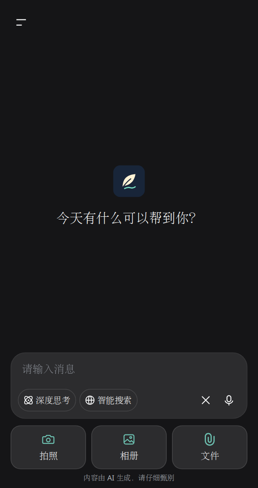
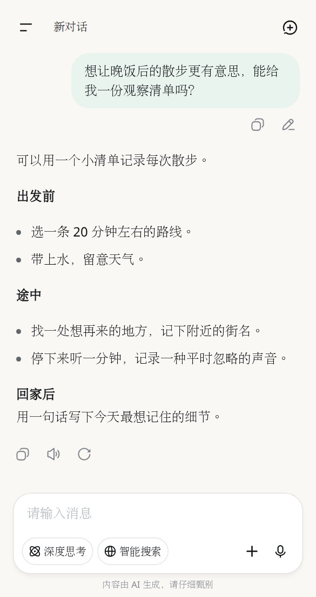

  

<h1 align="center">Inkbrisk</h1>

直连 DeepSeek API 的轻量聊天客户端

  <a href="#安装">安装</a> ·
  <a href="#选择模型">选择模型</a> ·
  <a href="PRIVACY.md">隐私说明</a> ·
  <a href="docs/BUILDING.md">从源码构建</a>

Inkbrisk 是基于 DeepSeek 开源 Chat Demo 的独立客户端。手机直接连接 DeepSeek API，聊天历史保存在本机。API 费用由 DeepSeek 按个人的账户用量计收。 [DeepSeek 模型与价格](https://api-docs.deepseek.com/zh-cn/quick_start/pricing/)

  
  

<em>Inkbrisk 界面预览，布局参考 DeepSeek 官方 App。</em>

## Motivation

最近，几位朋友在使用 DeepSeek 官方 App 和网页端时，多次因达到用量上限而中断对话。即使他们愿意付费继续使用，也没有对应的充值订阅入口。唯一充值渠道是只能按量调用 API 的 DeepSeek 开放平台。对于不熟悉 API 调用和使用的用户来说，即使完成充值并创建了 API Key，也无法在手机上类似官方app的使用体验进行聊天。

为此，Inkbrisk 将 DeepSeek 的对话、深度思考和附件功能整合在一个轻量开源的 Android 客户端中。应用预设了官方 API 地址和默认模型，用户安装后只需填入自己的 API Key，即可在熟悉的聊天界面中开始对话。

## 安装

需要 Android 7.0（API 24）或更新版本，以及 Chromium 105 或更新版本的 Android System WebView。

1. 在项目的发布页下载 `deepseek-mobile.apk`。 [GitHub Releases](https://github.com/HenceHzw/Inkbrisk/releases)
2. 在手机上打开 APK，根据系统提示允许当前文件管理器安装应用。
3. 在 DeepSeek 开放平台创建 API Key，然后在 Inkbrisk 中输入并验证。 [API Key 获取与配置指南](docs/API-KEY.md)

## 选择模型

默认使用 `deepseek-flash`。可在「设置 → 通用设置 → 模型」中切换，新选择会用于之后发送的消息。

| 模型 ID           | 支持的输入       |
| ----------------- | ---------------- |
| `deepseek-flash`  | 文字、图片、文件 |
| `deepseek-v4-pro` | 文字             |

`deepseek-flash` 还支持智能搜索和网页阅读。点输入框的「＋」可拍照、打开相册或选取文件。

两个模型都可开启「深度思考」。回复支持 Markdown、代码高亮、数学公式和 Mermaid 图表。你可以复制回复、重新生成，或点扬声器图标朗读。

语音输入使用 DeepSeek 在线转写，首次使用时需要麦克风权限。朗读使用 DeepSeek 在线合成语音，可在设置中选择海星（`stella`）或暗潮（`tide`）。

## 管理历史和附件

在「设置 → 数据管理」可导出或导入聊天 ZIP、清除本机 API Key，也可打开「DeepSeek 云端附件」逐个删除已上传文件。导入会覆盖本机历史；删除本机对话与删除云端附件是各自独立的操作。 [隐私说明](PRIVACY.md)

## 反馈

报告问题时，可在 GitHub Issues 中提供 Inkbrisk 版本、Android 版本、复现步骤和脱敏后的报错。请将 API Key、私密对话及历史备份保留在本机。

## 许可证

Inkbrisk 是独立项目，与 DeepSeek 无隶属关系。项目采用 MIT 许可证，保留上游 DeepSeek Chat Demo 的版权声明。第三方依赖适用各自的许可证。 [项目许可证](LICENSE) · [上游 Chat Demo](https://github.com/deepseek-ai/chat-demo/tree/429af5a4558469496b231631e850fbccc0c30c87)

Android 工程使用 Capacitor 模板（MIT）和 Gradle Wrapper（Apache 2.0）。APK 内含随包组件的许可声明。 [Capacitor 模板许可证](licenses/CAPACITOR-MIT.txt) · [Apache 2.0](licenses/APACHE-2.0.txt)
