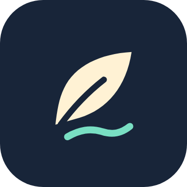

# Inkbrisk

**使用自己的 DeepSeek API Key，在 Android 手机上聊天。**

Inkbrisk 是基于 DeepSeek 开源 Chat Demo 的独立客户端。手机直接连接 DeepSeek API，聊天历史保存在本机。API 费用由 DeepSeek 按你的账户用量计收。 [DeepSeek 模型与价格](https://api-docs.deepseek.com/zh-cn/quick_start/pricing/)

[安装](#安装) · [选择模型](#选择模型) · [隐私说明](PRIVACY.md) · [从源码构建](docs/BUILDING.md)

## 安装

需要 Android 7.0（API 24）或更新版本，以及 Chromium 105 或更新版本的 Android System WebView。

1. 在本仓库的 **Releases** 中下载 `deepseek-mobile.apk`。也可以[从源码构建](docs/BUILDING.md)。
2. 在手机上打开 APK，根据系统提示允许当前文件管理器安装应用。
3. 在 DeepSeek 开放平台创建 API Key。打开 Inkbrisk，点「验证并开始」，在 Android 弹窗中输入 Key。 [创建 API Key](https://platform.deepseek.com/api_keys)

## 选择模型

在「设置 → 通用设置 → 模型」切换，选择会用于之后发送的消息。

| 模型              | 适用场景                                                                                   |
| ----------------- | ------------------------------------------------------------------------------------------ |
| **Flash**（默认） | 日常对话、智能搜索、阅读网页和处理图片或文件。点输入框的「＋」可拍照、打开相册或选取文件。 |
| **V4 Pro**        | 文字对话。                                                                                 |

两个模型都可开启「深度思考」。语音输入使用 DeepSeek 在线转写，首次使用时需要麦克风权限。回复下方的朗读按钮使用 DeepSeek 在线合成语音，可在设置中选择海星（`stella`）或暗潮（`tide`）。

## 管理历史和附件

在「设置 → 数据管理」可导出或导入聊天 ZIP、清除本机 API Key，也可打开「DeepSeek 云端附件」逐个删除已上传文件。导入会覆盖本机历史；删除本机对话与删除云端附件是各自独立的操作。 [隐私说明](PRIVACY.md)

## 从源码构建

在 Linux 上可运行浏览器开发预览，或构建 Android 调试 APK。也可以使用自己的签名密钥构建 APK。 [构建指南](docs/BUILDING.md)

## 反馈

报告问题时，可在 GitHub Issues 中提供 Inkbrisk 版本、Android 版本、复现步骤和脱敏后的报错。请将 API Key、私密对话及历史备份保留在本机。

## 许可证

Inkbrisk 是独立项目，与 DeepSeek 无隶属关系。项目采用 MIT 许可证，保留上游 DeepSeek Chat Demo 的版权声明。第三方依赖适用各自的许可证。 [项目许可证](LICENSE) · [上游 Chat Demo](https://github.com/deepseek-ai/chat-demo/tree/429af5a4558469496b231631e850fbccc0c30c87)

Android 工程使用 Capacitor 模板（MIT）和 Gradle Wrapper（Apache 2.0）。APK 内含随包组件的许可声明。 [Capacitor 模板许可证](licenses/CAPACITOR-MIT.txt) · [Apache 2.0](licenses/APACHE-2.0.txt)
